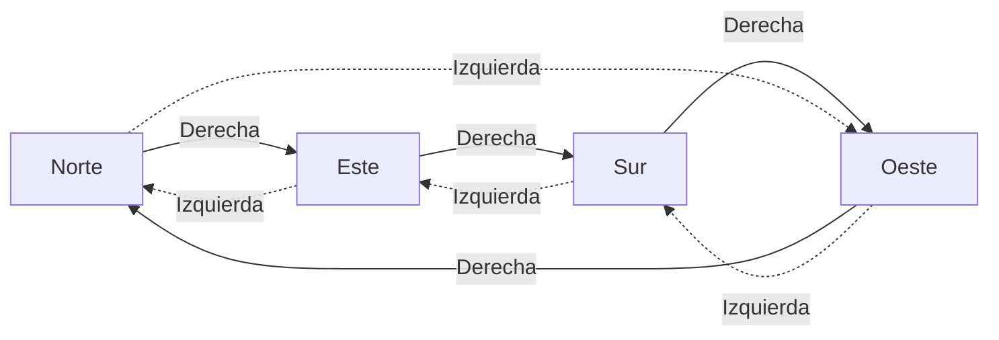

# Informe de proceso — Taller 2: un robot en la cuadrícula

Fundamentos de Programación Funcional y Concurrente.

Este informe explica cómo se ejecuta cada función paso a paso y muestra la
traza del robot en cada punto. Convención de coordenadas: avanzar hacia el
norte aumenta $y$ y avanzar hacia el este aumenta $x$. Un estado se escribe
`(x, y, mira)`.

## Punto 1: `girar`

### Cómo funciona

```scala
def girar(d: Direccion, s: Sentido): Direccion = (d, s) match {
  case (Norte, Derecha)   => Este
  case (Este,  Derecha)   => Sur
  case (Sur,   Derecha)   => Oeste
  case (Oeste, Derecha)   => Norte
  case (Norte, Izquierda) => Oeste
  case (Oeste, Izquierda) => Sur
  case (Sur,   Izquierda) => Este
  case (Este,  Izquierda) => Norte
}
```

1. Los dos argumentos se agrupan en una pareja `(d, s)`.
2. Scala recorre los casos de arriba hacia abajo y toma el primero cuyo patrón
   coincide con la pareja.
3. El resultado es la expresión a la derecha de la flecha de ese caso.

Hay $4 \times 2 = 8$ parejas posibles y hay 8 casos, uno por pareja. Como
`Direccion` y `Sentido` son `sealed`, el compilador avisa si falta alguno.
Girar a la derecha sigue el ciclo Norte → Este → Sur → Oeste → Norte, y girar
a la izquierda lo recorre al revés.



### Traza

| Llamado | Pareja evaluada | Caso que coincide | Resultado |
|---|---|---|---|
| `girar(Norte, Derecha)` | `(Norte, Derecha)` | primero | `Este` |
| `girar(Norte, Izquierda)` | `(Norte, Izquierda)` | quinto | `Oeste` |
| `girar(Oeste, Derecha)` | `(Oeste, Derecha)` | cuarto | `Norte` |
| `girar(Sur, Izquierda)` | `(Sur, Izquierda)` | séptimo | `Este` |

Cuatro giros a la derecha desde el norte:
`Norte` → `Este` → `Sur` → `Oeste` → `Norte`. El robot queda mirando a donde
miraba al principio.

## Punto 2: `ejecutar`

### Cómo funciona

```scala
def ejecutar(e: Estado, o: Orden): Estado = o match {
  case Avanzar(n) => e.mira match {
    case Norte => e.copy(y = e.y + n)
    case Sur   => e.copy(y = e.y - n)
    case Este  => e.copy(x = e.x + n)
    case Oeste => e.copy(x = e.x - n)
  }
  case Girar(s) => e.copy(mira = girar(e.mira, s))
  case Repetir(veces, _) if veces <= 0 => e
  case Repetir(veces, orden) =>
    ejecutar(ejecutar(e, orden), Repetir(veces - 1, orden))
  case Secuencia(ordenes) =>
    ordenes.foldLeft(e)((acc, ord) => ejecutar(acc, ord))
}
```

La función tiene un caso por cada alternativa de `Orden`:

1. **`Avanzar(n)`**: se mira la dirección del robot. Hacia el norte o el sur
   cambia $y$ (suma o resta $n$), y hacia el este o el oeste cambia $x$. Si
   $n$ es negativo, el robot retrocede sin ningún código adicional.
2. **`Girar(s)`**: la posición no cambia, solo `mira`, que se calcula con
   `girar` del punto 1.
3. **`Repetir(veces, orden)`**:
  - Si `veces <= 0`, devuelve el estado sin cambios.
  - Si no, ejecuta la orden una vez y repite lo que falta con `veces - 1`.
    Como `veces` baja en cada llamado, la recursión termina.
4. **`Secuencia(ordenes)`**: `foldLeft` ejecuta las órdenes de izquierda a
   derecha, y cada una parte del estado que dejó la anterior. Con la lista
   vacía devuelve el estado inicial.

### Traza: el cuadrado

Sea $S$ = `Secuencia(List(Avanzar(1), Girar(Derecha)))`. Se ejecuta
`ejecutar(inicial, Repetir(4, S))`, con `inicial = (0, 0, Norte)`.

| Paso | Orden ejecutada | Estado después | Orden que queda |
|---|---|---|---|
| 0 | (inicio) | `(0, 0, Norte)` | `Repetir(4, S)` |
| 1 | `Avanzar(1)` | `(0, 1, Norte)` | `Girar(Derecha)`, luego `Repetir(3, S)` |
| 2 | `Girar(Derecha)` | `(0, 1, Este)` | `Repetir(3, S)` |
| 3 | `Avanzar(1)` | `(1, 1, Este)` | `Girar(Derecha)`, luego `Repetir(2, S)` |
| 4 | `Girar(Derecha)` | `(1, 1, Sur)` | `Repetir(2, S)` |
| 5 | `Avanzar(1)` | `(1, 0, Sur)` | `Girar(Derecha)`, luego `Repetir(1, S)` |
| 6 | `Girar(Derecha)` | `(1, 0, Oeste)` | `Repetir(1, S)` |
| 7 | `Avanzar(1)` | `(0, 0, Oeste)` | `Girar(Derecha)`, luego `Repetir(0, S)` |
| 8 | `Girar(Derecha)` | `(0, 0, Norte)` | `Repetir(0, S)` |
| 9 | (nada: `veces <= 0`) | `(0, 0, Norte)` | ninguna |

El resultado es `Estado(0, 0, Norte)`: el cuadrado devuelve al robot al punto
de partida, mirando al norte.

```mermaid
flowchart LR
    A["(0,0,Norte)"] -->|"Avanzar(1)"| B["(0,1,Norte)"]
    B -->|"Girar(Derecha)"| C["(0,1,Este)"]
    C -->|"Avanzar(1)"| D["(1,1,Este)"]
    D -->|"Girar(Derecha)"| E["(1,1,Sur)"]
    E -->|"Avanzar(1)"| F["(1,0,Sur)"]
    F -->|"Girar(Derecha)"| G["(1,0,Oeste)"]
    G -->|"Avanzar(1)"| H["(0,0,Oeste)"]
    H -->|"Girar(Derecha)"| I["(0,0,Norte)"]
```



### Traza: avanzar, girar y avanzar

`ejecutar(inicial, Secuencia(List(Avanzar(2), Girar(Derecha), Avanzar(4))))`

| Paso | Orden ejecutada | Estado después |
|---|---|---|
| 0 | (inicio) | `(0, 0, Norte)` |
| 1 | `Avanzar(2)` | `(0, 2, Norte)` |
| 2 | `Girar(Derecha)` | `(0, 2, Este)` |
| 3 | `Avanzar(4)` | `(4, 2, Este)` |

### Traza: casos límite

| Llamado | Qué ocurre | Resultado |
|---|---|---|
| `ejecutar(inicial, Avanzar(-2))` | mira al norte, $y = 0 + (-2)$ | `(0, -2, Norte)` |
| `ejecutar(inicial, Repetir(0, Avanzar(5)))` | `veces <= 0`, devuelve `e` | `(0, 0, Norte)` |
| `ejecutar(inicial, Secuencia(Nil))` | `foldLeft` sin elementos devuelve `e` | `(0, 0, Norte)` |
 