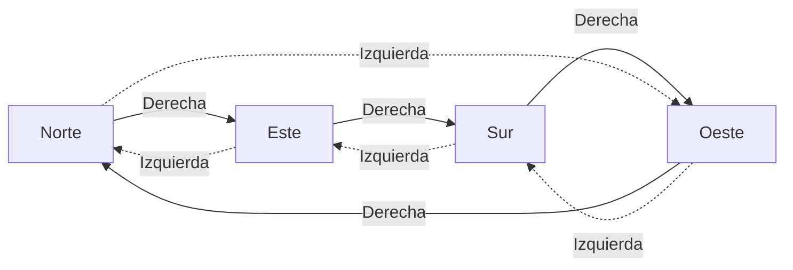
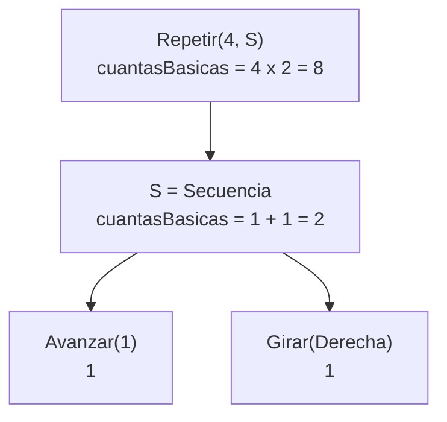

# Informe de proceso — Taller 2: un robot en la cuadrícula

Fundamentos de Programación Funcional y Concurrente.

Este informe explica cómo se ejecuta cada función paso a paso y muestra la
traza del robot en cada punto. Convención de coordenadas: avanzar hacia el
norte aumenta $y$ y avanzar hacia el este aumenta $x$. Un estado se escribe
`(x, y, mira)`.

## Punto 1: `girar`

### Cómo funciona

```scala
def girar(d: Direccion, s: Sentido): Direccion = (d, s) match {
  case (Norte, Derecha)   => Este
  case (Este,  Derecha)   => Sur
  case (Sur,   Derecha)   => Oeste
  case (Oeste, Derecha)   => Norte
  case (Norte, Izquierda) => Oeste
  case (Oeste, Izquierda) => Sur
  case (Sur,   Izquierda) => Este
  case (Este,  Izquierda) => Norte
}
```

1. Los dos argumentos se agrupan en una pareja `(d, s)`.
2. Scala recorre los casos de arriba hacia abajo y toma el primero cuyo patrón
   coincide con la pareja.
3. El resultado es la expresión a la derecha de la flecha de ese caso.

Hay $4 \times 2 = 8$ parejas posibles y hay 8 casos, uno por pareja. Como
`Direccion` y `Sentido` son `sealed`, el compilador avisa si falta alguno.
Girar a la derecha sigue el ciclo Norte → Este → Sur → Oeste → Norte, y girar
a la izquierda lo recorre al revés.



### Traza

| Llamado | Pareja evaluada | Caso que coincide | Resultado |
|---|---|---|---|
| `girar(Norte, Derecha)` | `(Norte, Derecha)` | primero | `Este` |
| `girar(Norte, Izquierda)` | `(Norte, Izquierda)` | quinto | `Oeste` |
| `girar(Oeste, Derecha)` | `(Oeste, Derecha)` | cuarto | `Norte` |
| `girar(Sur, Izquierda)` | `(Sur, Izquierda)` | séptimo | `Este` |

Cuatro giros a la derecha desde el norte:
`Norte` → `Este` → `Sur` → `Oeste` → `Norte`. El robot queda mirando a donde
miraba al principio.

## Punto 2: `ejecutar`

### Cómo funciona

```scala
def ejecutar(e: Estado, o: Orden): Estado = o match {
  case Avanzar(n) => e.mira match {
    case Norte => e.copy(y = e.y + n)
    case Sur   => e.copy(y = e.y - n)
    case Este  => e.copy(x = e.x + n)
    case Oeste => e.copy(x = e.x - n)
  }
  case Girar(s) => e.copy(mira = girar(e.mira, s))
  case Repetir(veces, _) if veces <= 0 => e
  case Repetir(veces, orden) =>
    ejecutar(ejecutar(e, orden), Repetir(veces - 1, orden))
  case Secuencia(ordenes) =>
    ordenes.foldLeft(e)((acc, ord) => ejecutar(acc, ord))
}
```

La función tiene un caso por cada alternativa de `Orden`:

1. **`Avanzar(n)`**: se mira la dirección del robot. Hacia el norte o el sur
   cambia $y$ (suma o resta $n$), y hacia el este o el oeste cambia $x$. Si
   $n$ es negativo, el robot retrocede sin ningún código adicional.
2. **`Girar(s)`**: la posición no cambia, solo `mira`, que se calcula con
   `girar` del punto 1.
3. **`Repetir(veces, orden)`**:
  - Si `veces <= 0`, devuelve el estado sin cambios.
  - Si no, ejecuta la orden una vez y repite lo que falta con `veces - 1`.
    Como `veces` baja en cada llamado, la recursión termina.
4. **`Secuencia(ordenes)`**: `foldLeft` ejecuta las órdenes de izquierda a
   derecha, y cada una parte del estado que dejó la anterior. Con la lista
   vacía devuelve el estado inicial.

### Traza: el cuadrado

Sea $S$ = `Secuencia(List(Avanzar(1), Girar(Derecha)))`. Se ejecuta
`ejecutar(inicial, Repetir(4, S))`, con `inicial = (0, 0, Norte)`.

| Paso | Orden ejecutada | Estado después | Orden que queda |
|---|---|---|---|
| 0 | (inicio) | `(0, 0, Norte)` | `Repetir(4, S)` |
| 1 | `Avanzar(1)` | `(0, 1, Norte)` | `Girar(Derecha)`, luego `Repetir(3, S)` |
| 2 | `Girar(Derecha)` | `(0, 1, Este)` | `Repetir(3, S)` |
| 3 | `Avanzar(1)` | `(1, 1, Este)` | `Girar(Derecha)`, luego `Repetir(2, S)` |
| 4 | `Girar(Derecha)` | `(1, 1, Sur)` | `Repetir(2, S)` |
| 5 | `Avanzar(1)` | `(1, 0, Sur)` | `Girar(Derecha)`, luego `Repetir(1, S)` |
| 6 | `Girar(Derecha)` | `(1, 0, Oeste)` | `Repetir(1, S)` |
| 7 | `Avanzar(1)` | `(0, 0, Oeste)` | `Girar(Derecha)`, luego `Repetir(0, S)` |
| 8 | `Girar(Derecha)` | `(0, 0, Norte)` | `Repetir(0, S)` |
| 9 | (nada: `veces <= 0`) | `(0, 0, Norte)` | ninguna |

El resultado es `Estado(0, 0, Norte)`: el cuadrado devuelve al robot al punto
de partida, mirando al norte.

```mermaid
flowchart LR
    A["(0,0,Norte)"] -->|"Avanzar(1)"| B["(0,1,Norte)"]
    B -->|"Girar(Derecha)"| C["(0,1,Este)"]
    C -->|"Avanzar(1)"| D["(1,1,Este)"]
    D -->|"Girar(Derecha)"| E["(1,1,Sur)"]
    E -->|"Avanzar(1)"| F["(1,0,Sur)"]
    F -->|"Girar(Derecha)"| G["(1,0,Oeste)"]
    G -->|"Avanzar(1)"| H["(0,0,Oeste)"]
    H -->|"Girar(Derecha)"| I["(0,0,Norte)"]
```



### Traza: avanzar, girar y avanzar

`ejecutar(inicial, Secuencia(List(Avanzar(2), Girar(Derecha), Avanzar(4))))`

| Paso | Orden ejecutada | Estado después |
|---|---|---|
| 0 | (inicio) | `(0, 0, Norte)` |
| 1 | `Avanzar(2)` | `(0, 2, Norte)` |
| 2 | `Girar(Derecha)` | `(0, 2, Este)` |
| 3 | `Avanzar(4)` | `(4, 2, Este)` |

### Traza: casos límite

| Llamado | Qué ocurre | Resultado |
|---|---|---|
| `ejecutar(inicial, Avanzar(-2))` | mira al norte, $y = 0 + (-2)$ | `(0, -2, Norte)` |
| `ejecutar(inicial, Repetir(0, Avanzar(5)))` | `veces <= 0`, devuelve `e` | `(0, 0, Norte)` |
| `ejecutar(inicial, Secuencia(Nil))` | `foldLeft` sin elementos devuelve `e` | `(0, 0, Norte)` |

## Punto 3 — `cuantasBasicas` y `profundidad`

Las dos funciones **miden una orden sin ejecutarla**: no tocan el estado del
robot, solo recorren el árbol de la orden. Por eso, en vez de una traza de
posiciones, mostramos la traza del cálculo y luego la contrastamos con la
traza de posiciones del cuadrado (§2.2).

### Cómo está escrita `cuantasBasicas`

```scala
def cuantasBasicas(o: Orden): Int = o match {
  case Avanzar(_) => 1
  case Girar(_) => 1
  case Repetir(veces, orden) =>
    if (veces <= 0) 0 else  veces * cuantasBasicas(orden)
  case Secuencia(ordenes) =>
    @annotation.tailrec
    def suma(pendientes: List[Orden], acum:Int): Int = pendientes match {
      case Nil => acum
      case h :: t => suma(t, acum + cuantasBasicas(h))
    }
    suma(ordenes, 0)
}
```

* Las órdenes básicas cuentan 1.
* `Repetir` multiplica las repeticiones por lo que cuenta la orden interior; con
  `veces <= 0` no se ejecuta nada y cuenta 0.
* `Secuencia` suma lo que cuenta cada elemento. La función interna `suma` es
  recursiva de cola: el total parcial viaja en `acum` y la pila no crece con
  el largo de la lista.
### Traza: `cuantasBasicas(cuadrado)`

Con $S \equiv \text{Secuencia}(\text{List}(\text{Avanzar}(1),\,\text{Girar}(\text{Derecha})))$,
`cuadrado` es $\text{Repetir}(4, S)$.

1. `cuantasBasicas(Repetir(4, S))` es $4 \times$ `cuantasBasicas(S)`.
2. `cuantasBasicas(S)` llama a `suma(List(Avanzar(1), Girar(Derecha)), 0)`:
   | Paso | `pendientes` | `acum` | Acción |
   |---|---|---|---|
   | 0 | `[Avanzar(1), Girar(Derecha)]` | 0 | `h = Avanzar(1)` cuenta 1, nuevo `acum = 0 + 1` |
   | 1 | `[Girar(Derecha)]` | 1 | `h = Girar(Derecha)` cuenta 1, nuevo `acum = 1 + 1` |
   | 2 | `[]` | 2 | caso base: devuelve `acum = 2` |

3. Resultado: $4 \times 2 = 8$.


**Contraste con la traza de posiciones.** El §2.2 muestra que ejecutar
`cuadrado` hace 8 transiciones del robot (4 avances y 4 giros). Es el mismo 8
que devuelve `cuantasBasicas`, sin haber ejecutado nada.

### Cómo está escrita `profundidad`

```scala
def profundidad(o: Orden): Int = o match {
  case Avanzar(_) => 1
  case Girar(_) => 1
  case Repetir(_,orden) => 1 + profundidad(orden)
  case Secuencia(ordenes) =>
    @annotation.tailrec
    def maximo(pendientes: List[Orden], mejor:Int): Int = pendientes match {
      case Nil => mejor
      case h :: t =>
        val ph = profundidad(h)
        maximo(t, if (ph > mejor)ph else mejor)
    }
    1 + maximo(ordenes, 0)
}
```

`maximo` recorre la lista guardando en `mejor` la profundidad más honda vista
hasta ahora. Empieza en 0 porque toda profundidad es al menos 1; con la
lista vacía devuelve 0 y `profundidad(Secuencia(Nil))` queda $1 + 0 = 1$,
como pide el enunciado.

### Traza: `profundidad(cuadrado)`

1. `profundidad(Repetir(4, S))` es $1 +$ `profundidad(S)`.
2. `profundidad(S)` es $1 +$ `maximo(List(Avanzar(1), Girar(Derecha)), 0)`:
   | Paso | `pendientes` | `mejor` | `ph` | Nuevo `mejor` |
   |---|---|---|---|---|
   | 0 | `[Avanzar(1), Girar(Derecha)]` | 0 | 1 | 1 |
   | 1 | `[Girar(Derecha)]` | 1 | 1 | 1 |
   | 2 | `[]` | 1 | — | devuelve 1 |

3. `profundidad(S)` $= 1 + 1 = 2$ y `profundidad(cuadrado)` $= 1 + 2 = 3$.
---

## Punto 4 — `componer`, `rutina`, `aplicarA` y `transformar`

### `componer`

```scala
def componer(o1: Orden, o2: Orden): Orden = Secuencia(List(o1, o2))
```

Ejemplo con `o1 = Avanzar(2)` y `o2 = Girar(Derecha)` desde `inicial`:

| Paso | Estado de entrada | Orden | Estado de salida |
|---|---|---|---|
| 1 | $(0,0,\text{Norte})$ | $\text{Avanzar}(2)$ | $(0,2,\text{Norte})$ |
| 2 | $(0,2,\text{Norte})$ | $\text{Girar}(\text{Derecha})$ | $(0,2,\text{Este})$ |

`ejecutar(inicial, componer(o1, o2))` da $(0,2,\text{Este})$, igual que
`ejecutar(ejecutar(inicial, o1), o2)`.

### `rutina`

```scala
def rutina(pasos: Int)(giro: Sentido)(veces: Int): Orden = {
  val paso: Orden = Secuencia(List(Avanzar(pasos), Girar(giro)))
  Repetir(veces, paso)
}
```

Su tipo es `Int => Sentido => Int => Orden`: cada par de paréntesis consume
una flecha. `rutina(2)(Derecha)` es una función de tipo `Int => Orden` que
espera las veces. `rutina(2)(Derecha)(3)` construye
$\text{Repetir}(3,\,\text{Secuencia}(\text{List}(\text{Avanzar}(2),\,\text{Girar}(\text{Derecha}))))$.

Traza de posiciones de `ejecutar(inicial, rutina(2)(Derecha)(3))`:

| Vuelta | Orden | Estado de entrada | Estado de salida |
|---|---|---|---|
| 1 | $\text{Avanzar}(2)$ | $(0,0,\text{Norte})$ | $(0,2,\text{Norte})$ |
| 1 | $\text{Girar}(\text{Derecha})$ | $(0,2,\text{Norte})$ | $(0,2,\text{Este})$ |
| 2 | $\text{Avanzar}(2)$ | $(0,2,\text{Este})$ | $(2,2,\text{Este})$ |
| 2 | $\text{Girar}(\text{Derecha})$ | $(2,2,\text{Este})$ | $(2,2,\text{Sur})$ |
| 3 | $\text{Avanzar}(2)$ | $(2,2,\text{Sur})$ | $(2,0,\text{Sur})$ |
| 3 | $\text{Girar}(\text{Derecha})$ | $(2,0,\text{Sur})$ | $(2,0,\text{Oeste})$ |

Con tres vueltas el robot recorre tres lados del cuadrado y queda en
$(2,0,\text{Oeste})$; con una cuarta volvería al origen.

### `aplicarA`

```scala
def aplicarA(estados: List[Estado], o: Orden): List[Estado] = {
  @annotation.tailrec
  def recorre(pendientes: List[Estado], acum: List[Estado]): List[Estado] =
    pendientes match {
      case Nil => acum.reverse
      case h :: t => recorre(t, ejecutar(h, o) :: acum)
    }
  recorre(estados, Nil)
}
```

Traza con `estados = List(inicial, Estado(5, 5, Sur))` y `o = Avanzar(2)`.
`::` agrega al frente en tiempo constante, así que `acum` va quedando en
orden inverso y el `reverse` final lo corrige.

| Paso | `pendientes` | `acum` | Acción |
|---|---|---|---|
| 0 | `[(0,0,Norte), (5,5,Sur)]` | `[]` | $(0,0,\text{Norte}) \to (0,2,\text{Norte})$ |
| 1 | `[(5,5,Sur)]` | `[(0,2,Norte)]` | $(5,5,\text{Sur}) \to (5,3,\text{Sur})$ |
| 2 | `[]` | `[(5,3,Sur), (0,2,Norte)]` | caso base: `acum.reverse` |

Resultado: `List(Estado(0,2,Norte), Estado(5,3,Sur))`. El robot mirando al sur
*baja* en $y$, por eso el segundo estado termina en $y=3$.

### `transformar`

```scala
def transformar(o: Orden, f: Orden => Orden): Orden = o match {
  case basica @ Avanzar(_)      => f(basica)
  case basica @ Girar(_)        => f(basica)
  case Repetir(veces, orden)    => Repetir(veces, transformar(orden, f))
  case Secuencia(ordenes)       =>
    @annotation.tailrec
    def recorre(pendientes: List[Orden], acum: List[Orden]): List[Orden] =
      pendientes match {
        case Nil    => acum.reverse
        case h :: t => recorre(t, transformar(h, f) :: acum)
      }
    Secuencia(recorre(ordenes, Nil))
}
```

`f` solo se aplica a las órdenes **básicas**; en `Repetir` y `Secuencia` se
conserva la estructura y se baja a los hijos. Traza con `cuadrado` y
`f = { case Avanzar(n) => Avanzar(2 * n); case otra => otra }`:

| Paso | Orden que se visita | Resultado |
|---|---|---|
| 1 | $\text{Repetir}(4, S)$ | $\text{Repetir}(4, \text{transformar}(S))$ |
| 2 | $S$, con `recorre` (`acum` en orden inverso) | ver filas siguientes |
| 3 | $\text{Avanzar}(1)$ | $f(\text{Avanzar}(1)) = \text{Avanzar}(2)$, `acum = [Avanzar(2)]` |
| 4 | $\text{Girar}(\text{Derecha})$ | $f(\text{Girar}(\text{Derecha})) = \text{Girar}(\text{Derecha})$, `acum = [Girar(Derecha), Avanzar(2)]` |
| 5 | fin de la lista | `acum.reverse` $= [\text{Avanzar}(2), \text{Girar}(\text{Derecha})]$ |

Resultado: $\text{Repetir}(4, \text{Secuencia}(\text{List}(\text{Avanzar}(2), \text{Girar}(\text{Derecha}))))$.
Al ejecutarla desde `inicial`, el robot recorre un cuadrado de lado 2:
$(0,0,N) \to (0,2,N) \to (0,2,E) \to (2,2,E) \to (2,2,S) \to (2,0,S) \to (2,0,O) \to (0,0,O) \to (0,0,N)$.


#### Traza de posiciones al ejecutar el cuadrado transformado (lado 2) desde `inicial`:

| Vuelta | Orden | Estado de entrada | Estado de salida |
|:---:|:---|:---:|:---:|
| 1 | `Avanzar(2)` | $(0,0,\text{Norte})$ | $(0,2,\text{Norte})$ |
| 1 | `Girar(Derecha)` | $(0,2,\text{Norte})$ | $(0,2,\text{Este})$ |
| 2 | `Avanzar(2)` | $(0,2,\text{Este})$ | $(2,2,\text{Este})$ |
| 2 | `Girar(Derecha)` | $(2,2,\text{Este})$ | $(2,2,\text{Sur})$ |
| 3 | `Avanzar(2)` | $(2,2,\text{Sur})$ | $(2,0,\text{Sur})$ |
| 3 | `Girar(Derecha)` | $(2,0,\text{Sur})$ | $(2,0,\text{Oeste})$ |
| 4 | `Avanzar(2)` | $(2,0,\text{Oeste})$ | $(0,0,\text{Oeste})$ |
| 4 | `Girar(Derecha)` | $(0,0,\text{Oeste})$ | $(0,0,\text{Norte})$ |


## Punto 5 — `simplificar`

`simplificar` **reescribe una orden en otra equivalente y más simple**, sin ejecutarla. Dos órdenes son equivalentes ($o \equiv o'$) si dejan al robot en el mismo estado final desde cualquier estado inicial.

### Reglas de reducción

| # | Regla | Reescritura |
|---|---|---|
| 1 | Órdenes nulas | `Avanzar(0)`, `Repetir(0, o)` → `Secuencia(Nil)` |
| 2 | Fusión de avances | `..., Avanzar(a), Avanzar(b), ...` → `..., Avanzar(a + b), ...` |
| 3 | Repetición unitaria | `Repetir(1, o)` → `o` |
| 4 | Secuencia unitaria | `Secuencia(List(o))` → `o` |
| 5 | Eliminar neutros | `..., Secuencia(Nil), ...` → `...` |

### Cómo funciona

```scala
def simplificar(o: Orden): Orden = {
  val s = paso(o)
  if (s == o) o else simplificar(s)   // se repite hasta el punto fijo
}

private def paso(o: Orden): Orden = o match {
  case Avanzar(0)                      => Secuencia(Nil)            // regla 1
  case Repetir(veces, _) if veces <= 0 => Secuencia(Nil)            // regla 1
  case Repetir(1, orden)               => paso(orden)               // regla 3
  case Repetir(veces, orden)           => Repetir(veces, paso(orden))
  case Secuencia(List(unica))          => paso(unica)               // regla 4
  case Secuencia(ordenes)              => Secuencia(limpiar(ordenes.map(paso)))
  case basica                          => basica
}

private def limpiar(ordenes: List[Orden]): List[Orden] = {
  @annotation.tailrec
  def recorre(pendientes: List[Orden], acum: List[Orden]): List[Orden] =
    pendientes match {
      case Nil                 => acum.reverse
      case Secuencia(Nil) :: t => recorre(t, acum)                   // regla 5
      case Avanzar(b) :: t     => acum match {
        case Avanzar(a) :: resto => recorre(t, Avanzar(a + b) :: resto) // regla 2
        case _                   => recorre(t, Avanzar(b) :: acum)
      }
      case h :: t              => recorre(t, h :: acum)
    }
  recorre(ordenes, Nil)
}
```

1. `paso` aplica las reglas una vez, de arriba hacia abajo, simplificando también los hijos.
2. `limpiar` recorre una secuencia y elimina neutros (regla 5) y fusiona avances contiguos (regla 2). Como en `aplicarA`, `acum` va en orden inverso y se corrige con `reverse`.
3. `simplificar` repite `paso` hasta que ya no cambia nada (punto fijo).

### Traza 1: fusión y neutros

`simplificar(Secuencia(List(Avanzar(1), Avanzar(2), Secuencia(Nil))))`

| Iteración | Orden antes | Regla aplicada | Orden después |
|---|---|---|---|
| 1 | `Secuencia(List(Avanzar(1), Avanzar(2), Secuencia(Nil)))` | 2 (fusión) y 5 (neutro) | `Secuencia(List(Avanzar(3)))` |
| 2 | `Secuencia(List(Avanzar(3)))` | 4 (secuencia unitaria) | `Avanzar(3)` |
| 3 | `Avanzar(3)` | ninguna (punto fijo) | `Avanzar(3)` |

Comprobación desde `inicial = (0, 0, Norte)`:
ambas órdenes dan `(0, 3, Norte)`.

### Traza 2: repetición unitaria y orden nula

`simplificar(Repetir(1, Secuencia(List(Avanzar(0), Girar(Derecha)))))`

| Iteración | Orden antes | Regla aplicada | Orden después |
|---|---|---|---|
| 1 | `Repetir(1, Secuencia(List(Avanzar(0), Girar(Derecha))))` | 3, luego 1 y 5 dentro | `Secuencia(List(Girar(Derecha)))` |
| 2 | `Secuencia(List(Girar(Derecha)))` | 4 | `Girar(Derecha)` |
| 3 | `Girar(Derecha)` | ninguna (punto fijo) | `Girar(Derecha)` |

Comprobación desde `inicial`: ambas dan `(0, 0, Este)`.

### Corrección

**Teorema.** Para toda orden $o$ y todo estado $e$:

$
\text{ejecutar}(e, \text{simplificar}(o)) = \text{ejecutar}(e, o)
$

**Demostración.** Basta ver que cada regla preserva `ejecutar`; después se procede por inducción estructural sobre $o$, porque `paso` solo reescribe subórdenes por otras equivalentes.

* **Regla 1.** `Avanzar(0)` suma $0$ a una coordenada y deja `mira` igual, así que devuelve `e`. `Repetir(0, o)` devuelve `e` por el caso `veces <= 0`. `Secuencia(Nil)` devuelve `e` porque `foldLeft` sin elementos devuelve el valor inicial. Las tres son la identidad.
* **Regla 2.** `Avanzar` no cambia `mira`, así que ambos avances ocurren en la misma dirección $d$. Con $(v_x, v_y)$ el vector unitario de $d$:


que es el resultado de `Avanzar(a + b)`.
* **Regla 3.** `ejecutar(e, Repetir(1, o))` ejecuta `o` una vez y luego `Repetir(0, o)`, que devuelve el estado sin cambios. Es igual a `ejecutar(e, o)`.
* **Regla 4.** `foldLeft` sobre `List(o)` hace una sola ejecución: `ejecutar(e, o)`.
* **Regla 5.** `Secuencia(Nil)` es la identidad, así que insertarla entre dos órdenes no cambia el resultado del `foldLeft`. 